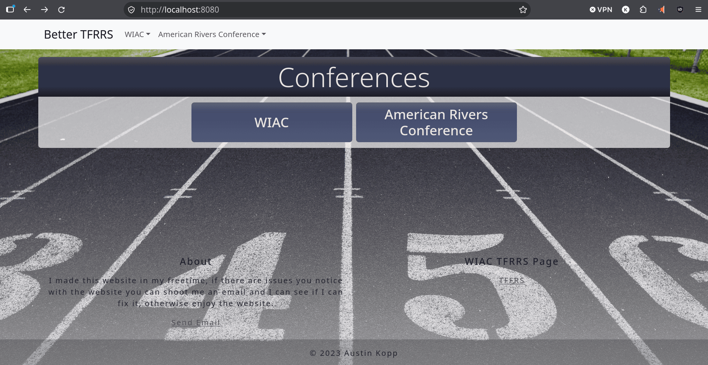
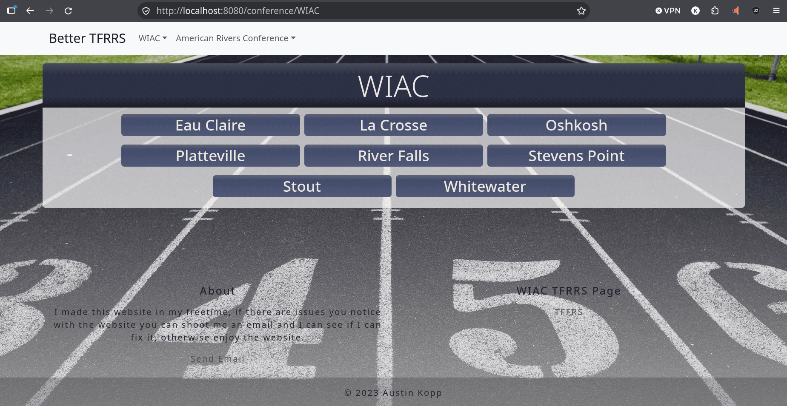
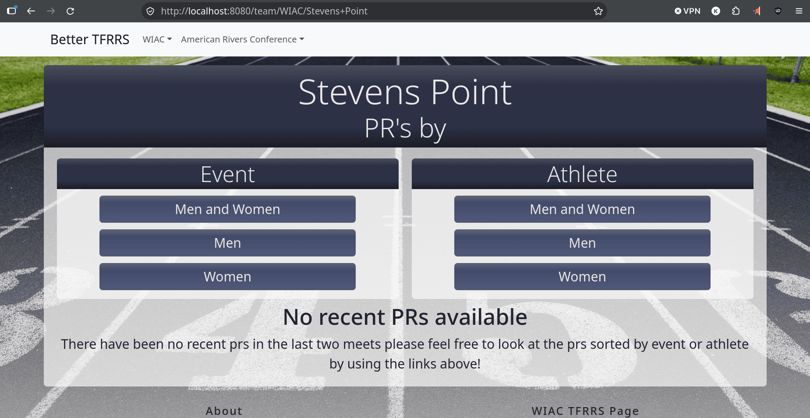
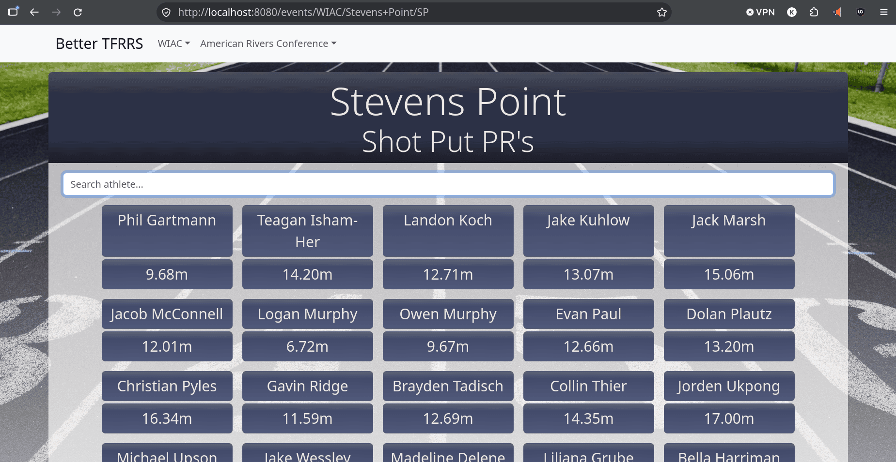
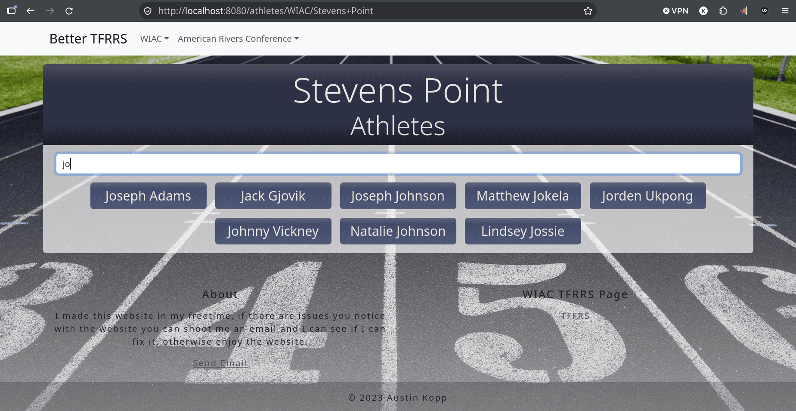

# Better TFRRS

A DIII track & field stats aggregator. Scrapes TFRRS for conference, team, athlete, and personal record data, then serves it as a browsable site covering the WIAC and American Rivers conferences.

| Home | WIAC Conference | Stevens Point |
|---|---|---|
|  |  |  |

| Event | Team Atheltes + athlete search |
|---|---|
|  |  |

## Origins

This project started in January 2022. I was in charge of the instagram throws page (our subgroup of the track team shotput, weight, discus, hammer, javelin) for my college track team. One issue I encountered while running this was gathering and keeping track of which teammates achieved a new personal record (PR) each week. This required navigating through the TFRRS website and identifying who PR'd and then formatting it into an instagram post. Additionally, we needed to let our throws coach know on which throw number and who PR'd so we could post the associated videos. After doing this for a while I realized it seemed to be a good place to add some automation. This is where the first iteration of the project came around. It simply grabbed the HTML and then parsed and pulled out the necessary data. I would then organize and send off an email to myself and our throws coach with the necessary information to identify who PR'd and what throw it was on.

This worked for the first year, but then I realized it would be nice to see what my thrower teammates PR's were at track meets. This is what lead to the first iteration of the website that was written in python and utilized django as the web framework. Eventually I had that up and working and further realized, this would be incredibly useful to be able to check on PR's for everyone on the team regardless of their event. So I set off to get the data for runners and jumpers as well. That lead to the final version of the python version of the website. This was stable and ran even after I graduated from college and was utilized by the track coach and old teammates that still remained on the team.

That leads into the creation of this Java version of the website. After having a real programming job for a while I realized I missed my project and wanted to explore setting up in a language other than python. This is when I began porting the website to java utilizing the spring boot framework. I also wanted to explore expanding the website further and that's when I added the rest of the WIAC conference. Finally, my wife's sister was participating in track in a different conference and I expanded the website to include the American Rivers Conference as well. That brings us to today and where this website stands. One part of the website utilizes some python code from another project. That simply gathers all teams PR's in the last 2 weeks and generates json that I parse and display.

Working on this project on and off for about 4 years taught me a lot about python, java, webframeworks, databases, AWS, GCP, linux, and owning/managing a domain.

> **Archived.** Last active November 2025. The site is no longer deployed and the scraper is no longer running against TFRRS, which had begun blocking repeated requests — the known blocker for resuming this work.

## Architecture

Data flows in one direction, with each layer responsible for one concern:

```
TFRRS pages
    │
    ▼
scraper/     Jsoup parsing. One class per page type, each exposing a method
    │        that takes a parsed Document and returns domain objects.
    │        No database or Spring knowledge here.
    ▼
service/     Upsert logic. Decides whether scraped data is a new row or an
    │        update to an existing one, then calls the repository.
    ▼
repository/  Spring Data JPA interfaces, derived queries plus a few @Query
    │        declarations for distinct-event lookups.
    ▼
H2 database  File-based, schema managed by Hibernate ddl-auto=update.
    │
    ▼
dtos/        Assemble entities into exactly the shape a template needs, so
    │        controllers stay thin and Thymeleaf never touches entities.
    ▼
website/     @Controller classes rendering Thymeleaf templates.
```

**Scraper and website share one artifact.** `BetterTfrrsWebsiteApplication` inspects its CLI arguments at startup. With no arguments it starts as a normal Spring Boot web server on port 8080. With `scrape` it boots the same context with `WebApplicationType.NONE`, so the web layer is never started, then calls `PopulateAndUpdateDB.run()`. One jar, two modes, no separate build or deployment.

**Scraping is rate-limit aware.** `openHTMLPage` retries failed requests up to five times with exponential backoff (10s, 20s, 40s, 80s) and rethrows on the final attempt. A full scrape of both conferences takes 15-20 minutes when TFRRS is throttling; during the offseason it drops to about a minute because team pages are empty and only conferences and teams need collecting.

**Upserts are keyed on stable identifiers.** The original implementation keyed athletes on name and team, which broke because teams genuinely have two athletes with the same name and because a team's TFRRS URL can change between seasons. Athletes are now keyed on link, and the website resolves individual athletes by database ID rather than by name.

## Requirements

- Java 21 (the Gradle toolchain pins this, and will provision it if needed)
- Any OS — `gradlew` is cross-platform

## Build

1. Clone the repo
2. `cd` into the repo root
3. Run `./gradlew build`

The build produces a single runnable jar at `build/libs/BetterTfrrs.jar`.

## Running

```bash
java -jar build/libs/BetterTfrrs.jar            # start the website
java -jar build/libs/BetterTfrrs.jar scrape     # scrape TFRRS and populate the database
```

Run from the repo root. The H2 database is file-backed relative to the working directory, so running from elsewhere puts `data/` somewhere unexpected.

The website is at **localhost:8080**.

Scrape takes 15-20 minutes on average, depending on whether TFRRS has started blocking requests. You can stop it early and keep whatever data it collected. In production this ran as a cron job scheduled nightly around midnight.

When not in season the team pages have no data, so no athletes may be scraped.

To view the database, go to **localhost:8080/h2-console** with JDBC URL `jdbc:h2:file:./data/bettertfrrsdb`, user `sa`, and no password.

## Recent PRs data

Each team page also shows personal records from the last two weeks, which come from meet results rather than from the TFRRS scrape.

The Python script that generates this data lives in a separate repository, [`GetLast2WeeksPrsForJava2025`](https://github.com/koppperqu/GetLast2WeeksPrsForJava2025); this repo owns the consumption side. `TeamController` reads the JSON directory configured by the `last2weeksprsjson` property in `application.properties`, resolves one file per team using a `team-name-with-hyphens_lowercase_recentrPRs.json` convention, and deserializes it into `MeetDTO` via Jackson for rendering in `teamPage.html`. The files checked into `Last2WeeksPrsJson/` are samples. A missing or unreadable file renders an empty section rather than failing the page.

## What I'd do next

- **Region-level scraping.** `PopulateAndUpdateDB` has a prepared `D3RegionLinks` array of thirteen DIII regions that is currently unused. The missing piece is one method that reads a region page and returns its conference links; conference, team, and athlete scraping all already work and would not need to change.
- **Replace `ddl-auto=update` with migrations.** Flyway would make schema changes reviewable and reversible. Not urgent while the scraper is the only writer.
- **Tests for the scrapers.** The scraper classes are pure functions over a Jsoup `Document`, so they can be unit tested against saved HTML fixtures with no network and no Spring context. They are currently constructed with `new` in `PopulateAndUpdateDB` rather than injected, which would need to change first.
- **Handle TFRRS rate limiting properly.** A shared token bucket and respecting `robots.txt` would make the scrape survivable at a larger scope.
- **Remove the disabled `assert` statements in the scrapers.** Assertions are off by default under `java -jar`, so those checks currently do nothing at runtime. Since TFRRS layout changes are the primary failure mode, they should be real exceptions with useful messages.

## License

MIT — see [LICENSE](LICENSE).
